# Design language

How askme looks, behaves and speaks. A change to the page follows this file. The screens it describes are in [`design/screens/`](design/screens/) as pictures, and in [`design/mockup/`](design/mockup/index.html) as static pages you can open.

How the styles are written in code is a separate decision: [ADR 14](adr/0014-styling.md) and [`constraints/styling.md`](constraints/styling.md).

## Principles

1. **One at a time.** The ask at the top of the list gets most of the screen. The rest wait below as a compact list. Nothing shows a priority number.
2. **The colour is the person's.** Colour on the page means a hashtag, which is a part of someone's life. askme has no brand colour of its own.
3. **Black is for neutral things.** Text, the Everything tab and actions that belong to no hashtag.
4. **The words carry the mood.** No illustration and no decoration. When there is something to celebrate, the type gets big and the copy gets light.
5. **Plain words.** Sentence case, whole sentences, no exclamation marks. A button says what happens when you press it.

## Screens

| List | Card open | A hashtag's tab |
| --- | --- | --- |
| 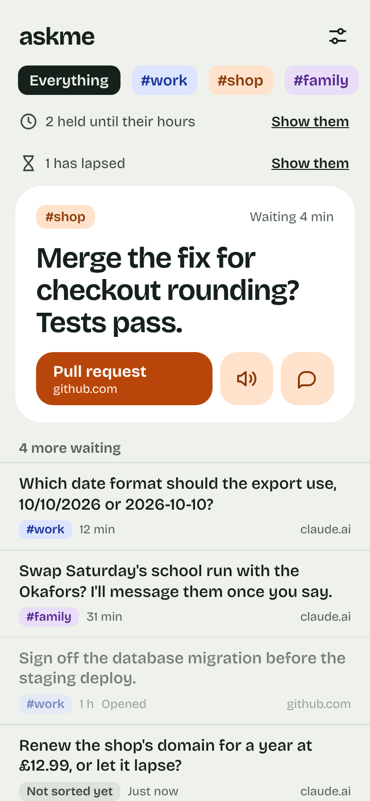 | 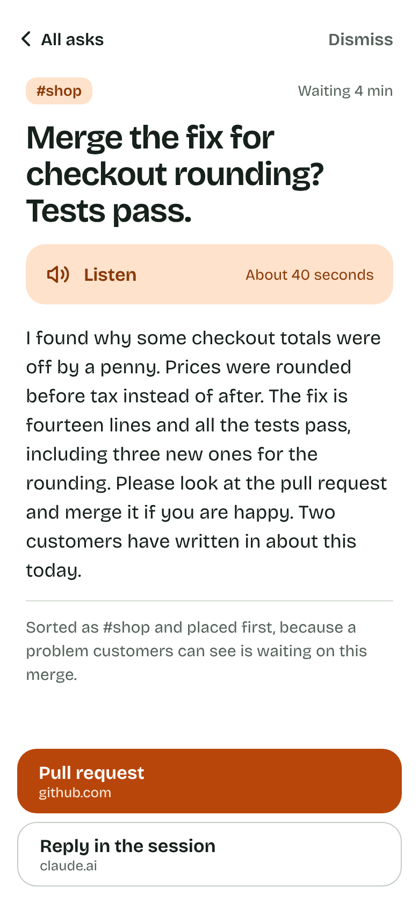 | 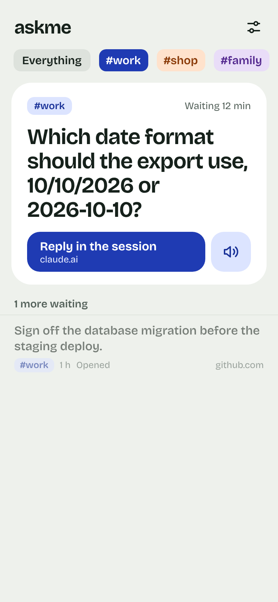 |

| All clear | New account | Top card states |
| --- | --- | --- |
| 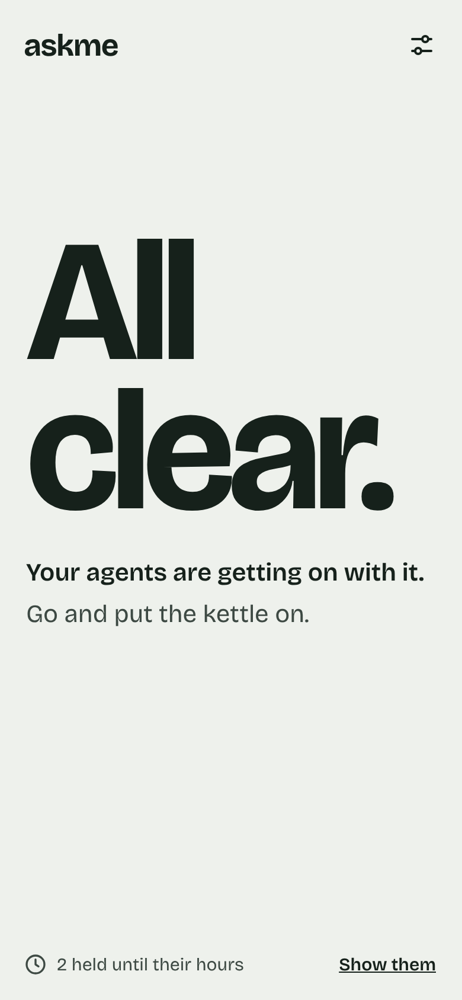 | 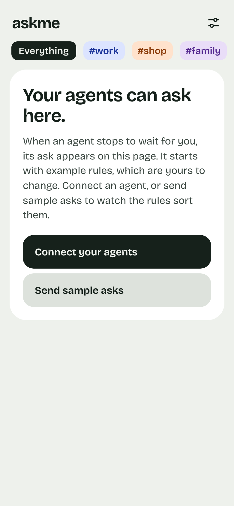 | 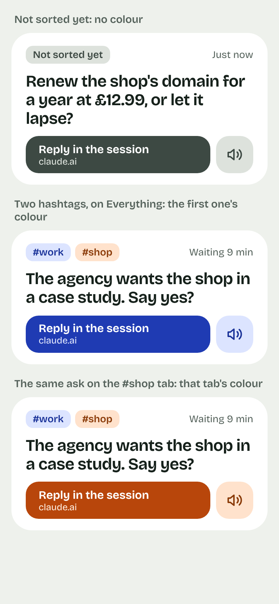 |

| Rules | Connect your agents | Signed out |
| --- | --- | --- |
| 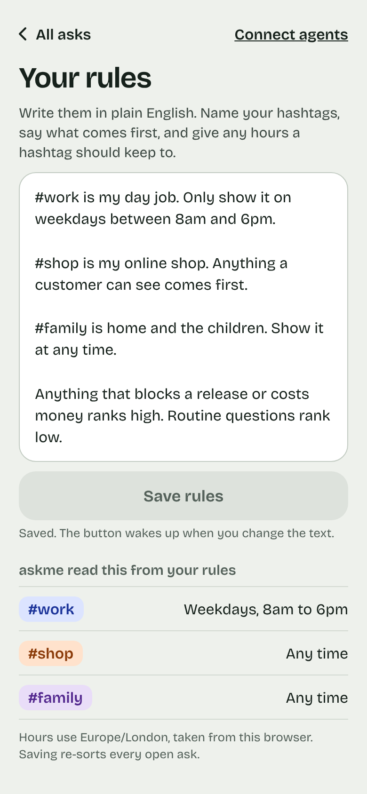 | 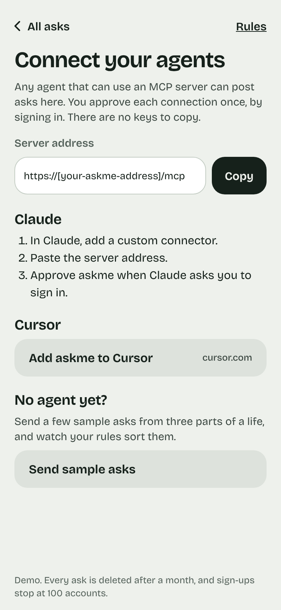 | 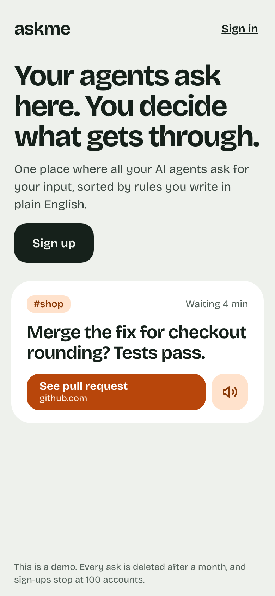 |

The sorting line sits under the tabs, below the held and lapsed lines when they show.

| While sorting | Sorting stopped |
| --- | --- |
| 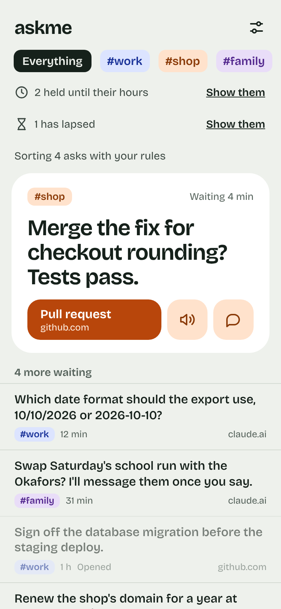 | 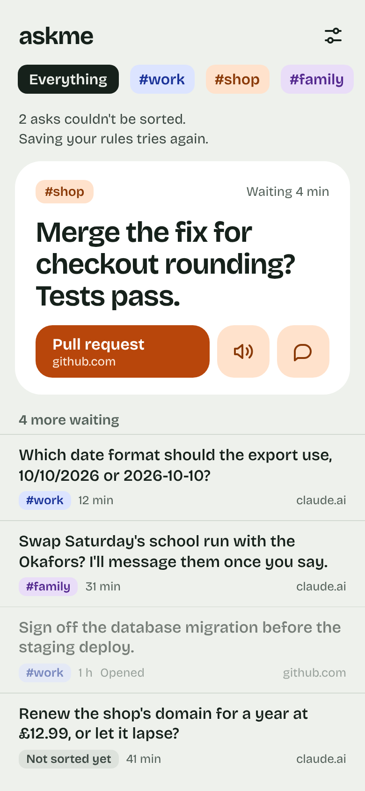 |

At desktop width the first ask sits on the left with its spoken text, and the rest of the list on the right.

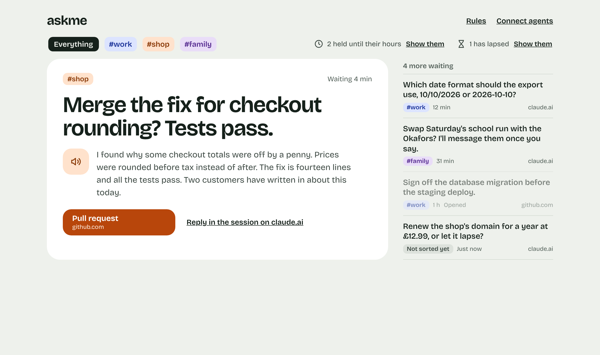

With one ask waiting, the list keeps its place and says nothing else is waiting. At desktop width the card is as wide as it is beside a longer list.

| One ask on a phone | One ask at desktop width |
| --- | --- |
| 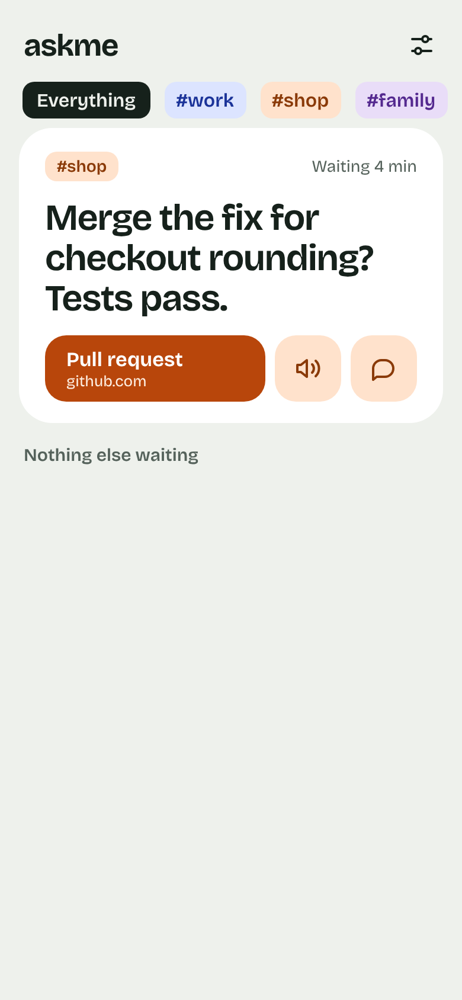 | 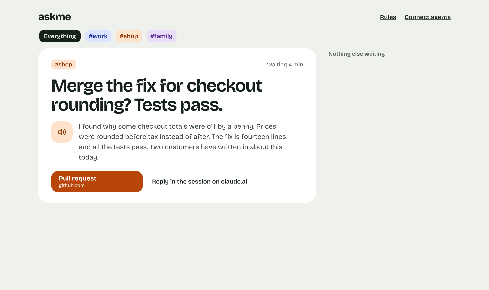 |

## Colour

### Neutral

| Token | Value | Used for |
| --- | --- | --- |
| `--ground` | `#EEF1EC` | The page background |
| `--surface` | `#FFFFFF` | The top card, text boxes, the open card |
| `--ink` | `#16211B` | Text, the Everything tab, neutral main buttons |
| `--text-2` | `#3D4943` | Body text of lesser weight, the unsorted button |
| `--text-3` | `#55625B` | Small labels, ages, site names, notes |
| `--line` | `#D3DAD2` | Hairlines between rows |
| `--border` | `#C3CCC3` | The edge of a text box or an outlined button |
| `--neutral-tint` | `#DDE2DC` | "Not sorted yet", neutral second buttons, a disabled button |

### Hashtag colours

Each hashtag gets one colour from this fixed set. The person never picks a colour, so every pairing below has been checked for contrast.

| Name | Strong | Tint | Ink on tint |
| --- | --- | --- | --- |
| blue | `#1F3BB3` | `#DCE4FF` | `#1B3399` |
| orange | `#B8460B` | `#FFE2CC` | `#8A3A08` |
| purple | `#6D3BB5` | `#E9DDF8` | `#54298F` |
| teal | `#0B6F6A` | `#D3EFEC` | `#0A5450` |
| magenta | `#A8246E` | `#FBDCEC` | `#861B57` |
| olive | `#5E6B12` | `#E7ECC4` | `#48520D` |
| sky | `#0E6A8F` | `#D5ECF6` | `#0B526E` |
| gold | `#8A5A00` | `#F6E4BF` | `#6B4600` |

- **Strong** is a fill that carries white text: a main button, a selected tab.
- **Tint** is a fill that carries the ink colour beside it: a pill, a second button.
- White on every strong, and each ink on its tint, is at least 4.5 to 1.

### Colour rules

1. **A hashtag gets the next colour in the table when it first appears, and keeps it.** Editing the rules does not reshuffle colours. A ninth hashtag starts the table again.
2. **A hashtag looks the same everywhere.** A tinted pill in a tab, on a card and in a list row.
3. **On Everything, an ask's buttons take the colour of its first hashtag.** First means the order the hashtags appear in the rules.
4. **On a hashtag's own tab, every ask's buttons take that tab's colour.**
5. **An ask that is not sorted yet has no colour.** Its main button is `--text-2` and its second button is `--neutral-tint`.
6. **A screen with no hashtag in play uses ink.** Save rules, Copy, Connect your agents, Sign up.
7. **Colour never carries meaning alone.** The hashtag's name is always written beside it.

## Type

One family: Bricolage Grotesque, the variable font, served from the site itself.

| Use | Size | Line height | Weight | Letter spacing |
| --- | --- | --- | --- | --- |
| "All clear." | 146px, or less on a screen narrower than 354px | 0.86 | 700 | -0.04em |
| Signed-out headline | 42px | 1.02 | 700 | -0.035em |
| Top ask at desktop width | 48px | 1.04 | 650 | -0.03em |
| Top ask, screen titles | 31px | 1.1 | 650 | -0.025em |
| Wordmark | 26px | 1 | 700 | -0.03em |
| Lines under "All clear." | 21px | 1.35 | 600, then 400 | 0 |
| Section heading | 20px | 1.2 | 650 | -0.01em |
| Spoken text | 18px | 1.5 | 400 | 0 |
| Row summary, button label | 17px | 1.26 | 550 for a summary, 650 for a button | 0 |
| Tabs, links, body | 16px | 1.45 | 400, or 600 for a control | 0 |
| Notes, the held and lapsed lines | 15px | 1.4 | 400, or 600 for a label | 0 |
| Pills, ages, site names | 13px to 14px | 1.3 | 400, or 600 in a pill | 0 |

Lines of running text stay under 80 characters. At desktop width the spoken text has a maximum width of 34rem.

## Shape and space

| Thing | Value |
| --- | --- |
| Corner of a card or a sheet | 28px |
| Corner of a button or a text box | 18px |
| Corner of a pill | 10px, or 8px for the small pill in a list row |
| Smallest thing you can tap | 44px by 44px |
| Main button height | 56px, or 52px on a settings screen |
| Side padding | 20px for text, 16px outside a card, 22px inside one |
| Space at the foot of a screen | 26px |
| Room at the foot for a note | 57px, the note's height, kept while it shows |
| Gap between buttons | 8px |
| Phone layout | Designed at 390px wide. Nothing scrolls sideways. |
| Desktop layout | Content is at most 1080px wide and centred |

There are no shadows and no gradients. Depth comes from the white card on the grey-green ground.

## Parts

### Header

The wordmark, and at the right one control that opens the rules. At desktop width the right side has two text links: Rules and Connect agents. Nothing sits beside the wordmark: a tag there looks like a hashtag or a tab. The demo notice is on the signed-out page and on Connect your agents.

### Tabs

Everything first, then one tab per hashtag, in the order the hashtags appear in the rules.

| State | Everything | A hashtag |
| --- | --- | --- |
| Not selected | `--neutral-tint` with ink text | Its tint with its ink |
| Selected | Ink with ground-colour text | Its strong with white text |

### The held line

A hashtag can be limited to hours. An ask outside its hours is held back.

- When any asks are held, one line sits directly under the tabs: a clock, "2 held until their hours", and a "Show them" control.
- After "Show them" the line reads "Showing 2 held asks", and the control reads "Hide them".
- When nothing is held, the line is not there.
- It also shows on the All clear screen, at the foot.

### The lapsed line

An agent can say when its ask stops mattering. Once that time has passed, the ask is lapsed. It is not closed, and it is held back behind a line of its own, which looks like the held line.

- When any asks have lapsed, one line sits under the held line, or directly under the tabs when nothing is held: an hourglass, "2 have lapsed", and a "Show them" control. With one, it says "1 has lapsed".
- After "Show them" the line reads "Showing 2 lapsed asks", and the control reads "Hide them". The lapsed asks come after every other ask, longest waiting first. Each opens and dismisses like any other.
- An ask outside its hours stays held until its time has passed. Then it counts as lapsed, not held.
- When nothing has lapsed, the line is not there.
- It also shows on the All clear screen, at the foot, under the held line.
- At desktop width it sits beside the held line, at the right of the tabs.

### The sorting line

Saving the rules sorts every open ask again, and an ask can be left behind. One line says how sorting stands. It looks like the held line, with no clock and no control, and sits under the tabs, below the held and lapsed lines when they show.

- While the daily limit is reached: "Today's sorting limit is reached. It resets at 01:00." The time is in the person's time zone.
- Otherwise, while any asks are being sorted: "Sorting 40 asks with your rules".
- Otherwise, when sorting stopped for some asks: "3 asks couldn't be sorted. Saving your rules tries again."
- Only one of these shows, in that order. With none of them, the line is not there.

### The top card

The first ask in the list. White, with its hashtag pills, how long it has waited, the summary in large type, and a row of buttons.

- **Main button.** Strong fill. Two lines: what the link is, then the site it leads to. It opens the action link, or the session link when there is no action link.
- **Listen.** Tint fill, a speaker icon.
- **Session.** Tint fill, a speech-bubble icon. Shown only when the ask has both links.
- Tapping the summary opens the card.

### What the main button says

askme knows only the link's address, so the label comes from its shape.

| Link | Label |
| --- | --- |
| A GitHub pull request | Pull request |
| A GitHub issue | Issue |
| Any other action link | Go to, then the site's name |
| The session link | Reply in the session |

The second line is always the site's name, such as github.com. The list of recognised shapes can grow. It never uses words the agent supplied.

A recognised shape's label names what the link opens, with no verb. The button only ever opens a page, so a word such as "See" adds nothing, and the shorter label stays on one line beside the Listen and session buttons.

### List rows

Every ask after the first. A summary of up to two lines, then one line with the small hashtag pill, the age and the site name at the right. Rows are separated by hairlines and sit on the ground colour.

Tapping a row opens its card, the same as tapping the top card's summary. The site name says where the card's main button leads.

| State | How it looks |
| --- | --- |
| Open | As above |
| Opened | The whole row at 55% opacity, with "Opened" after the age. It sinks below unopened asks at its level. |
| Not sorted yet | A "Not sorted yet" pill in `--neutral-tint` where the hashtag would be |

Above the rows, one small heading counts them: "4 more waiting". When the top ask is the only one, the heading says "Nothing else waiting" and has no rows under it, on a phone and at desktop width. On a hashtag's tab it counts that tab's asks.

### The open card

A white screen. "All asks" at the top left goes back, and "Dismiss" is at the top right.

1. Hashtag pills and how long it has waited.
2. The summary.
3. Listen: a wide tint button with the speaker icon, the word "Listen" and the length, such as "About 40 seconds". Where the browser cannot speak, the button is not shown.
4. The spoken text.
5. The reason, under a hairline, in `--text-3`.
6. At the foot, the main button, and under it an outlined "Reply in the session" button when the ask has both links.

Swiping a row or the top card dismisses it. A note with "Undo" shows for a few seconds, and the dismissal is sent when it goes. If it fails, the card comes back with a note. If another dismissal is waiting at the time, its clock stops while the failure note shows. Its note with "Undo" then comes back for the full few seconds.

### All clear

Shown when nothing is waiting and the account has had at least one ask.

- "All clear." at 146px. On a screen narrower than 517px, such as a phone held upright, it takes two lines. On a screen 517px wide or more, such as at desktop width, it fits on one line inside the side padding.
- On a screen narrower than 354px, "clear." does not fit at 146px inside the 22px side padding. There the headline shrinks with the screen, so "clear." keeps 22px on each side. At 320px wide it is 130px.
- The headline and the two lines under it sit a third of the way down the space under the header, or under the tabs. The space above them is half the space below, down to the foot of the screen or to the first line at the foot, the held line or the lapsed line. On a screen too short for that, 26px stays above them.
- They stay where they are while a note shows at the foot of the screen. The held and lapsed lines move up out of the note's way. On a screen too short for that, they move up too, or the screen scrolls further, until 26px stays between the last line and the held line, the lapsed line or the note.
- The two lines under the headline balance their line breaks, so a line that wraps never leaves a word or two on their own.
- A fixed line in ink: "Your agents are getting on with it."
- A second line in `--text-2` that changes on each visit:
  - Go and put the kettle on.
  - Go outside for a bit.
  - Stretch your legs.
  - Look out of the window.
  - Finish that cup of tea.
  - Nothing to see here. Lovely.
- No buttons. The held line sits at the foot when asks are held, and the lapsed line under it when asks have lapsed.

### New account

Shown when the account has never had an ask. A white card says "Your agents can ask here.", explains in two sentences, and offers "Connect your agents" in ink and "Send sample asks" in `--neutral-tint`.

### Rules

- One text box, with a label above it that says what to write.
- "Save rules" is ink when the text has changed, or when some asks couldn't be sorted and the daily limit is not reached. Otherwise it is `--neutral-tint`. Under it, one short note gives the state: "Saved.", "Reading your rules.", "Sorting your asks again." for a save of unchanged rules, or what went wrong.
- Below, what askme read from the rules: each hashtag's pill with its hours, or "Any time". This list changes only when a save finishes.
- A last note names the time zone and says that saving changed rules re-sorts every open ask, and saving them unchanged sorts again any that couldn't be sorted.
- At the foot, under a hairline: the person's email address in `--text-3`, and "Sign out" at the right in ink, underlined, like "Show them". "Sign out" stays on the address's line, and a long address wraps beside it. With no email address, "Sign out" stands alone. The screen is taller than a phone, so the foot is reached by scrolling.
- "Sign out" ends the session and shows the signed-out page.
- "All asks" goes back. Leaving with unsaved text asks first, and so does "Sign out".

### Connect your agents

The server address in a read-only box with a Copy button, steps for Claude as a numbered list, a button for Cursor, and "Send sample asks" for someone with no agent yet. The demo notice is at the foot. The header has only "All asks", which goes back. There is no Rules link.

### Signed out

The headline, one sentence about the product, "Sign up" in ink, a picture of a top card, and the demo notice.

## Words

- Sentence case everywhere. No capitals for emphasis.
- No exclamation marks. Errors do not apologise.
- A button names its action: "Save rules", "Show them", "Send sample asks".
- An action keeps its name. The tab says Everything, so nothing else calls it "All".
- Times are short: "Just now", "4 min", "1 h", "2 d". The top card says "Waiting 4 min".
- A time of day is on the 24-hour clock, in the person's time zone, as in "It resets at 01:00".

| Moment | Words |
| --- | --- |
| A poll fails | Not connected. Trying again. |
| The daily cap is reached | You've reached today's limit. It resets at 01:00. |
| Too many presses | Slow down a little. Try again in a few seconds. |
| Reading the rules fails | askme couldn't read your rules just now. Your text is saved. Try again. |
| A dismissal fails | That didn't go through. The ask is back. |
| Asks have lapsed | 2 have lapsed |
| Asks are being sorted | Sorting 40 asks with your rules |
| Sorting stopped for some asks | 3 asks couldn't be sorted. Saving your rules tries again. |
| The daily sorting limit is reached | Today's sorting limit is reached. It resets at 01:00. |
| Dismissed | Dismissed. Undo |

## Movement

- Movement answers something the person did: a card slides away on a swipe, a row dims when opened, the held or lapsed asks appear when shown.
- Nothing moves by itself, and nothing loops.
- When the person's device asks for reduced motion, changes happen at once.

## Access

- Text is at least 4.5 to 1 against what it sits on.
- Everything works from a keyboard, and focus is always visible: a 2px ink outline, 2px away from the control.
- When the list goes all clear while a tab has focus, the tabs go and focus moves to the "All clear." headline, so a screen reader says what happened. The headline is not a control, so it draws no outline, and Tab never stops on it.
- When a card closes, the list is back where it was, and focus goes to the row or top card that opened the card. If that ask has left the list or moved in it, focus goes to the ask that came after it, or with none left, to the last ask in the list. If the ask that takes focus is not wholly on the screen, the page scrolls only as far as it takes to show it and its outline, clear of the note.
- A button is a `button`, and a link is an `a` with an address. An icon-only control has a spoken label.
- A link that opens a new tab says so to a screen reader. Its spoken name ends with "(opens in a new tab)", and the screen does not show these words. These links are the card's buttons to the work and to the agent's session, and "Add askme to Cursor".
- Nothing you can tap is smaller than 44px by 44px.

## Later

- A picture made for the moment on the All clear screen.
- A dark theme.
